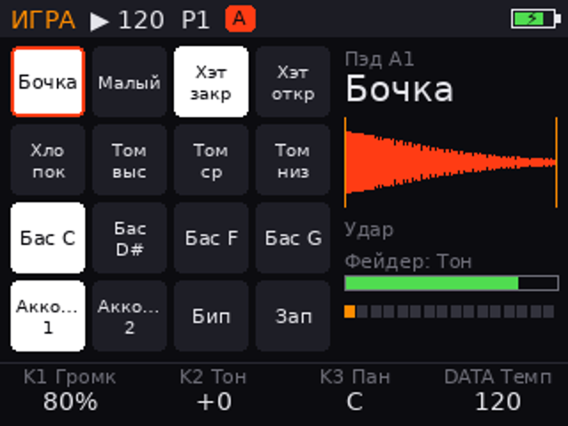
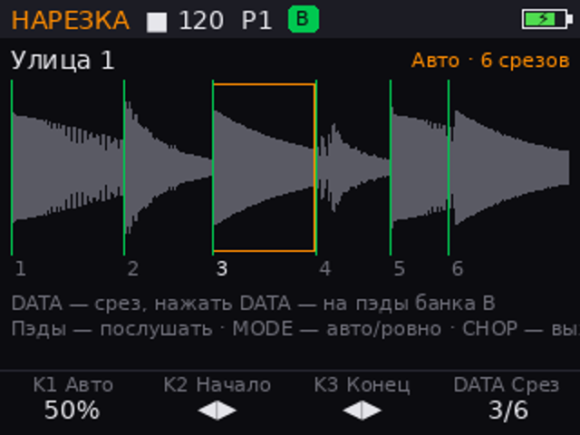
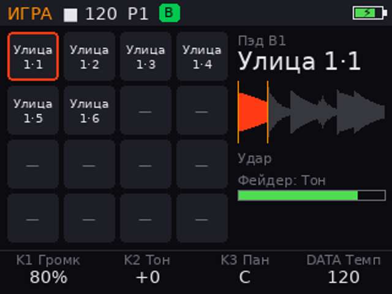
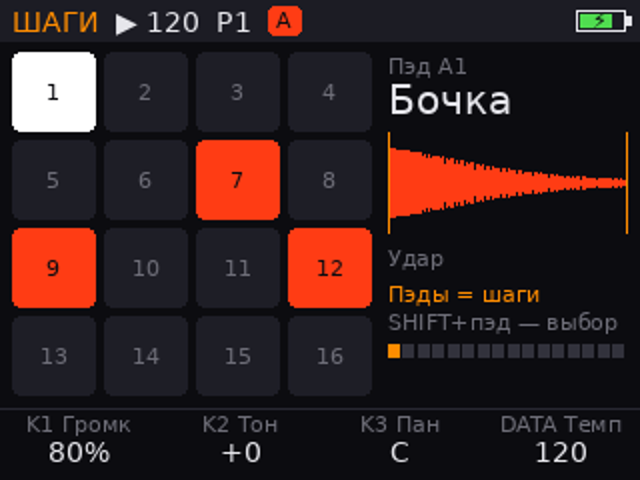
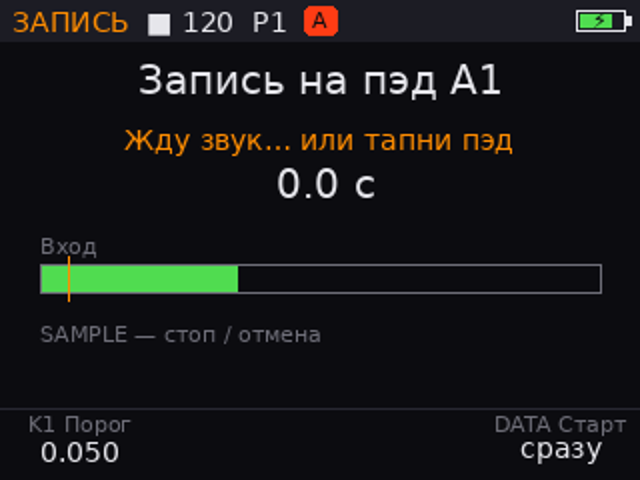
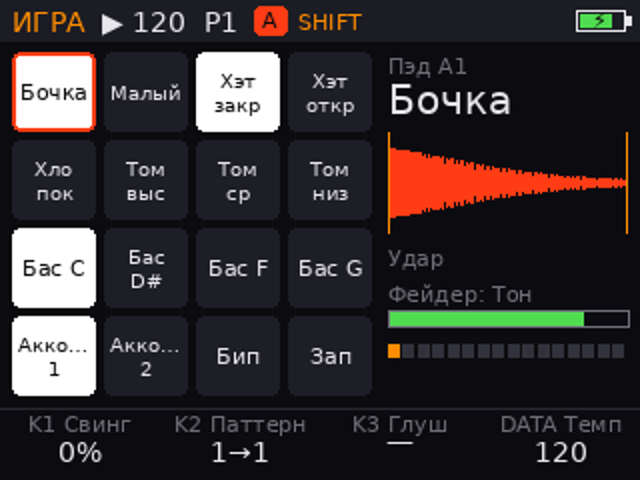

# SAMPLEY

Самодельный **сэмплер в духе MPC на Raspberry Pi Zero W / Zero 2 W**, 132 × 160 мм (спереди 24, сзади 34 — экран на наклонной панели): 16 мягких
силиконовых пэдов с подсветкой и силой удара, экран 2″ (без тачскрина — всё на крутилках), 3 крутилки и
энкодер DATA, фейдер, встроенные микрофон и динамики, наушники, линейный вход,
аккумулятор.

Вышел на улицу → **SAMPLE** → тапнул пэд → записал → **CHOP** → звук сам
порезался по пэдам → играешь бит, пишешь паттерн, крутишь фейдером тон или
фильтр. Зарядка по USB-C, работает во время зарядки — «встроенный UPS», как
UPS-Lite, только на своей плате.

Сделан по образцу [KODY](https://github.com/kl1ms1/KODY): Pi вставляется в
плату «бутербродом», кнопками и питанием занимается свой микроконтроллер,
софт на Python с симуляцией на компьютере.

**3D-модель (крутится пальцем, пэды звучат):** https://claude.ai/artifact/BT3mzjpjLoUAFnGqiVNAwn

| Игра | Нарезка (CHOP) | Срезы на пэдах банка B |
|---|---|---|
|  |  |  |
| **Шаги** | **Запись** | **SHIFT** |
|  |  |  |

Картинки — настоящий вывод программы. Послушать встроенные звуки и демо-бит:
[`docs/demo.wav`](docs/demo.wav) — всё синтезировано кодом.

## Документы

- [`docs/concept.md`](docs/concept.md) — как выглядит, все кнопки, CHOP, электроника, питание, реализуемость
- [`docs/breadboard.md`](docs/breadboard.md) — **этап 1:** макетка из готовых модулей, распиновка, установка
- [`docs/shopping-list.md`](docs/shopping-list.md) — что купить
- [`docs/roadmap.md`](docs/roadmap.md) — план

## Коротко о железе

| Блок | Чем |
|---|---|
| Мозги | Raspberry Pi Zero 2 W (или Zero W — меньше голосов, больше задержка) |
| Звук | Кодек WM8960: наушники, 2 динамика по 1 Вт, микрофон, линейный вход |
| Экран | 2.0″ IPS 320×240, ST7789, SPI, без тачскрина |
| Пэды, 15 кнопок, 3 крутилки + DATA, фейдер, громкость, подсветка | Микроконтроллер RP2040 ↔ Pi по UART |
| Питание | USB-C → BQ25895 (зарядка + работа при зарядке) → TPS61088 (5 В), защита DW01A, проценты MAX17048, ползунок с безопасным выключением |

## Софт

```
software/
  sampley/
    engine.py      звуковой движок: голоса, тон, режимы, глушение, NOTE REPEAT, фейдер
    chop.py        CHOP: нарезка по ударам или ровно
    sequencer.py   16 шагов × 8 паттернов × 64 пэда, свинг, запись вживую
    recorder.py    запись с микрофона / линии с автостартом
    library.py     библиотека записей и WAV на карте
    kit.py         наборы на карте памяти (WAV + kit.json)
    kit_synth.py   встроенные звуки, синтезированные кодом
    app.py         что делают пэды, кнопки и крутилки на каждом экране
    ui.py          экран 320×240
    controls.py    протокол с микроконтроллером
    hw.py          экран ST7789, UART, датчик заряда (свой или UPS-Lite), звук
    board.py       Zero W / Zero 2 W — выбирается само
    pins.py        карта GPIO
  tests/           python3 -m unittest
  install.sh       установка на Pi + автозапуск
firmware/pico/main.py   прошивка микроконтроллера (MicroPython)
tools/gen_shopping_list.py
tools/gen_model.py       3D-модель → docs/model/sampley-model.html
```

Запуск:

```bash
cd software
python3 -m unittest discover -s tests -t .   # тесты
python3 -m sampley --demo ../out             # демо-бит в WAV + картинки экранов, без железа
python3 -m sampley --sim                     # на компьютере: окно + клавиатура (pip install pygame sounddevice scipy)
python3 -m sampley                           # на Pi
```

В симуляции: пэды — `1234 / qwer / asdf / zxcv`; K1 `5 6`, K2 `t y`, K3 `g h`
(нажатие `7 u j`); DATA — `← →` или колесо мыши (нажатие `↓` или средняя
кнопка мыши); фейдер `[ ]`. Shift — SHIFT, Пробел — PLAY, Backspace — STOP,
Enter — REC, Tab — REPEAT, F1–F10 — SAMPLE, STEP, CHOP, MUTE, MODE, LEVELS,
BANK, TAP, BROWSE, KITS.
